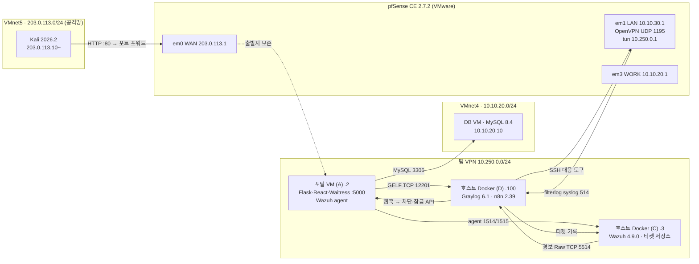

# 해담시청 민원포털 보안 관제·자동 대응 (개인 재구성)

> **팀 프로젝트를 PC 한 대에서 혼자 설치·실행·실측할 수 있도록 다시 구성한 개인 포트폴리오 저장소입니다.**
> 상태(2026-11-19): **6개 케이스 모두 이 PC에서 탐지 → 자동 대응까지 실측.** S1·S4·S8·S10은 효과 확인·원복·티켓 종료까지 완주, S7은 팀에서 못 끝낸 Wazuh 자동 복구를 완성, S12는 탐지·판정 파이프라인 확인(안전 부하에서 정상 `no_action`). 진행 기록은 [docs/journal](docs/journal/), 발표 자료는 [docs/portfolio](docs/portfolio/).

## 실측 결과 (이 PC, 2026-11-16 · 케이스당 1회)

| 케이스 | 공격 입력 | 자동 대응 | 효과·원복 | 티켓 |
| --- | --- | --- | --- | --- |
| **S1** 로그인 무차별 대입 | Kali `.11` 로그인 401 ×9 | 포털 IP 차단 | `.11` 403 · 정상 `.100` 200 → 해제 후 200 | T-20261116-0001 closed |
| **S4** 실패 뒤 성공 | Kali `.12` 401 ×5 + 200 ×1 | 계정 잠금·세션 회수 | 기존 세션 무효, 오잠금 0 → 비밀번호 재설정 원복 | T-20261116-0002 closed |
| **S8** 스캔 → 로그인 | Kali `.21` 404 다수 + 401 | 포털 IP 차단 | `.21` 403 · `.100` 200 → 해제 | T-20261116-0003 closed |
| **S10** 3계층 연쇄 | Kali `.22` 스캔 + 로그인 + 경계 두드림 | 포털 + pfSense 경계 차단 | 경계 → 앱 순서 해제 | T-20261116-0004 closed |
| **S7** 홈페이지 변조 | `index.html` 변조 · 새 파일 생성 | Wazuh active response 복구·격리 | 해시가 기준본과 일치(`verify ok`), 새 파일은 격리(404) | T-20261116-0005 verified |
| **S12** 요청 폭주 | Kali `.41` 최대 100 req/s, 240초, 20,781건 | 헬스체크 판정 | p95 554.7ms ≤ 기준 2000ms → `no_action`(오차단 0) | — |

S1 대응 시간: 조건 충족 → 차단 **약 3.7초**, 마지막 실패 → 차단 49초(Graylog 1분 평가 주기), 차단 → 효과 확인 38초, 오차단 0.

**남은 한계(정직하게):** S10의 pfSense 경계 차단이 HTTP 새 연결을 막지 못해 실제 차단은 앱 단에서 이루어짐(포트 포워드 규칙과 평가 순서 문제로 추정). S7 티켓은 닫기 가드가 2단계 복구를 기대해 `verified`에서 멈춤. 효과 확인·해제는 사람이 수행(원복 워크플로 `haedam-50`은 dry_run 고정). 케이스별 반복 실측(목표 3~5회)은 아직.

## 팀 원본과 내 역할

| 항목 | 내용 |
| --- | --- |
| 팀 | 1조 **NoBugs** (2026-10 ~ 11-06 본발표) |
| 팀 원본 저장소 | [NoBugs-Aleph/aleph-soar-capstone](https://github.com/NoBugs-Aleph/aleph-soar-capstone) · [haedam-portal-backend](https://github.com/NoBugs-Aleph/haedam-portal-backend) · [haedam-portal-frontend](https://github.com/NoBugs-Aleph/haedam-portal-frontend) |
| 팀원 | 반소람(A · 포털·대응 API, S1·S4) · 김명준(B · 망·pfSense·VPN, S8·S10, 포털 구현) · **김상혁(C · Wazuh·S7, 티켓 저장소·보안 대시보드)** · 김대훈(D · Graylog·n8n, S12) |
| 내 역할(팀) | C 자리 — Wazuh 서버·agent·FIM, S7 홈페이지 변조 탐지·복원, 티켓 저장소·보안 대시보드 |
| 이 저장소에서 내가 한 일 | 팀 4대(PC A·B·C·D)를 PC 한 대로 재배치: pfSense VM 4-NIC·OpenVPN 서버 구성, 포털·DB VM 무인 설치, Docker 구성 단일 PC화, Graylog·n8n 설정 자동 반입, pfSense 대응 도구 연결, 민감정보 검사 도구, 실측 |
| 출처 | 파일별 원작자는 [CREDITS.md](CREDITS.md). 팀원 코드는 원본 커밋 그대로 반입했고, 고친 곳은 파일 머리말과 git 이력에 남겼습니다. |

## 구성도

팀은 PC 4대를 팀 VPN(OpenVPN, 10.250.0.0/24)으로 묶었습니다. 이 저장소는 **같은 주소·같은 VPN 구조**를 한 PC에 올립니다.



### 주소 표 (팀과 동일)

| 이름 | 위치 | 주소 | 이 PC에서 접속 |
| --- | --- | --- | --- |
| pfSense WAN / LAN / DMZ / WORK | VMware VM | 203.0.113.1 / 10.10.30.1 / 10.10.10.1 / 10.10.20.1 | 웹 `https://10.10.30.1` |
| OpenVPN 서버 | pfSense | UDP 10.10.30.1:1195, 터널 10.250.0.1 | — |
| 포털 (A) | VMware VM | VMnet7 10.10.30.20, VPN **10.250.0.2**:5000 | 공격망에서 `http://203.0.113.1/` |
| DB | VMware VM | 10.10.20.10:3306 | 포털에서만 |
| Wazuh·티켓 저장소 (C) | 호스트 Docker | VPN **10.250.0.3** (1514·1515·55000·8088) | 대시보드 `https://127.0.0.1:5601`, 티켓 `http://127.0.0.1:8089` |
| Graylog·n8n (D) | 호스트 Docker | VPN **10.250.0.100** (12201·514·5514) | Graylog `http://127.0.0.1:9000`, n8n `http://127.0.0.1:5678` |
| 공격자 | Kali VM | 203.0.113.10 (+S1 .11 · S4 .12 · S8 .21 · S10 .22) | — |

## 사전 준비

| 항목 | 값 |
| --- | --- |
| PC | Windows 10/11, RAM 16GB, 디스크 여유 60GB 이상, BIOS 가상화(SVM/VT-x) 켬 |
| 프로그램 | Docker Desktop(WSL2), VMware Workstation Pro 17, OpenVPN Community 2.6+, Python 3.12, Git |
| `%USERPROFILE%\.wslconfig` | 아래 내용 → `wsl --shutdown` 후 Docker Desktop 재시작 |

```ini
[wsl2]
memory=9GB
processors=8
swap=4GB
kernelCommandLine = sysctl.vm.max_map_count=262144

[experimental]
autoMemoryReclaim=dropCache
sparseVhd=true
```

설치 이미지(팀과 같은 버전, SHA-256 확인): pfSense CE 2.7.2 (`atxfiles.netgate.com/mirror/downloads/`), Ubuntu 24.04 Server, Kali 2026.2 VMware. 체크섬은 [작업 일지](docs/journal/2026-11-10.md#설치-이미지-팀과-같은-버전)에 있습니다.

## 설치 순서

> 각 단계의 상세 명령은 해당 폴더의 스크립트 머리말에 있습니다. 비밀값은 모두 `.env`(커밋 안 함)나 저장소 밖 폴더에 둡니다.

1. **VMware 가상망** — VMnet4 10.10.20.0/24, VMnet5 203.0.113.0/24, VMnet6 10.10.10.0/24(호스트 어댑터 없음), VMnet7 10.10.30.0/24(호스트 10.10.30.10). DHCP 끔.
2. **pfSense VM** — NIC 4개(e1000, VMnet5·7·6·4 순서), ISO 설치(UFS) → 콘솔에서 WAN em0 203.0.113.1/24, LAN em1 10.10.30.1/24 → 콘솔 쉘에서 관리용 SSH 키 등록 → [`infra/pfsense/configure_lab.php`](infra/pfsense/configure_lab.php) 실행(DMZ·WORK, 포트 포워드, OpenVPN, 고정 주소, 규칙, syslog, admin 비밀번호 교체, SSH 키 전용).
3. **VPN 클라이언트** — [`infra/pfsense/export_client.php`](infra/pfsense/export_client.php)로 team-a·c·d 프로필 생성. 호스트에 team-c·team-d 두 개(TAP 어댑터 2개), 포털 VM에 team-a.
4. **Windows 방화벽** — 관리자 PowerShell에서 [`tools/windows/allow-lab-firewall.ps1`](tools/windows/allow-lab-firewall.ps1) (VPN·관리망 출발지, 필요한 포트만).
5. **포털·DB VM** — [`infra/vm/make_vm.py`](infra/vm/make_vm.py) `portal` / `db`(Ubuntu 무인 설치, SSH 키 전용) → [`infra/db-vm/install_db.sh`](infra/db-vm/install_db.sh) → 프론트 빌드(`node:22-alpine`) → [`infra/portal-vm/install_portal.sh`](infra/portal-vm/install_portal.sh).
6. **Docker 구성**

   ```bash
   docker compose -f infra/graylog/docker-compose.yml up -d
   docker compose -f infra/n8n/docker-compose.yml up -d
   docker compose -f services/ticket-store/compose.yaml up -d --build
   docker compose -f infra/wazuh/generate-indexer-certs.yml run --rm generator
   docker compose -f infra/wazuh/docker-compose.yml up -d
   ```

   각 폴더의 `.env.example`을 `.env`로 복사해 값을 채웁니다(`infra/graylog`, `infra/n8n`, `infra/wazuh`, `services/ticket-store`, `services/portal/backend`). 같은 키는 여러 `.env`에 같은 값을 넣습니다(예: 티켓 저장소 키 = ticket-store `TICKET_STORE_KEY` = n8n `TICKET_STORE_KEY`). Wazuh 비밀번호는 compose 파일에 적지 않으며, 비어 있으면 compose가 변수 이름을 알려 주고 멈춥니다. VPN 연결 뒤 `BIND_IP`를 Graylog·n8n `10.250.0.100`, 티켓 저장소·Wazuh `10.250.0.3`으로 둡니다.
7. **Graylog 설정 반입** — `python infra/graylog/bootstrap.py` (입력·스트림·파이프라인·조회 테이블·알림·이벤트 정의. 다시 실행하면 "생성 0").
8. **n8n 반입** — `python infra/n8n/make_credentials.py --out <임시>` → 컨테이너에 복사 → `n8n import:credentials`, `n8n import:workflow --separate` → 임시 폴더의 자격 증명 파일 삭제.
9. **Wazuh agent** — 포털 VM에 4.9.0 설치, 매니저 10.250.0.3, 웹 루트 `/home/haedam/haedam-portal-frontend/dist` 실시간 FIM. 등록 뒤 `docker exec haedam-wazuh-wazuh.manager-1 /var/ossec/bin/agent_control -l`로 ID를 확인하고, `001`이 아니면 `infra/n8n/workflows/haedam-15`·`17`의 `agent` 값을 같은 ID로 바꿉니다.
10. **S7 자동 복구(AR)** — 포털 VM에 `lab/s7/restore/s7_restore.py` → `/opt/haedam-s7/bin/`, 래퍼 `s7-restore-ar` → `/var/ossec/active-response/bin/`(root:wazuh 0750), 기준본 생성(`s7_restore.py baseline`). 매니저 쪽 AR 블록은 `infra/wazuh/config/wazuh_cluster/wazuh_manager.conf`에 이미 들어 있습니다(상세: [lab/s7/restore/README.md](lab/s7/restore/README.md)).
11. **Kali(공격자)** — VMnet5에 붙이고 주소 `203.0.113.10/24`, 게이트웨이 `203.0.113.1`. 케이스별 출발지를 보조 주소로 붙입니다: `sudo ip addr add 203.0.113.{11,12,21,22,41,100}/24 dev eth0`(`.100`은 오차단 확인용 정상 사용자). 저장소를 Kali에 복제해 아래 입력 도구를 실행합니다.
12. **실제 대응 모드 켜기(회차 때만)** — 저장소 기본값은 관찰 모드(`dry_run`)입니다. 회차 전에 Graylog → Alerts → Notifications에서 해당 케이스 알림 본문 끝에 `"dry_run":false,"store_real":true`를 넣고, 그 케이스가 부르는 n8n 하위 워크플로(`haedam-10`~`17`)를 활성화합니다. 회차가 끝나면 되돌립니다.

## 매번 켤 때 순서 (중요)

Graylog(D)·티켓 저장소·Wazuh(C)는 팀처럼 **VPN 주소(10.250.0.100 / 10.250.0.3)에 포트를 엽니다.** VPN이 연결되기 전에 Docker가 뜨면 `bind: cannot assign requested address`로 이 컨테이너들이 멈춥니다(Docker Desktop 로그 `the specified IP ... is not owned by the host`).

1. pfSense VM 켜기 → 콘솔/SSH로 시각 확인(필요하면 `date -u`로 맞춤)
2. OpenVPN 서비스 시작 → `10.250.0.100`·`10.250.0.3`이 붙었는지 확인(`Get-NetIPAddress`)
3. Docker Desktop → 멈춘 컨테이너 시작(`docker start soc-graylog ticket-store haedam-wazuh-wazuh.manager-1 haedam-wazuh-wazuh.dashboard-1`)
4. DB VM → 포털 VM 순서로 켜기 → 포털 `health` 확인

끌 때는 반대 순서(포털·DB → Docker → OpenVPN → pfSense)입니다.

켠 뒤에는 `powershell -ExecutionPolicy Bypass -File tools\windows\lab-startup-check.ps1`로 한 번에 점검합니다(pfSense 시계, VPN 주소, 컨테이너, 서비스 응답, 포털 GELF 적체, Wazuh 에이전트 ID). 기본은 점검만 하고, `-FixClock`·`-StartContainers`·`-RestartPortal`을 줄 때만 고칩니다.

## 시나리오 재현 (테스트 명령 · 기대 결과)

공격 입력은 모두 Kali에서 pfSense WAN(`203.0.113.1:80`)으로 보냅니다. S1·S4·S8·S10·S7 도구는 기본으로 계획만 출력하고, `--execute`를 줄 때만 실제로 보냅니다. S12 도구는 바로 보내며, 속도·시간 상한이 코드에 고정돼 있습니다. 같은 케이스를 다시 할 때는 Graylog 알림 grace(S1 30분, S4 10분, S8·S10 15분, S7 10분, S12 1분)를 기다립니다.

| 케이스 | 입력 명령 (Kali) | 기대 결과 | 확인 방법 |
| --- | --- | --- | --- |
| S1 | `python3 lab/s1s4/s1_live_run.py --run-id S1-<날짜>-01 --execute` | 1분 안에 `.11` 차단 → `.11` 403, `.100` 200, 티켓 생성 | 포털 `GET /api/v1/response/ips`, 대시보드 `http://127.0.0.1:8089` |
| S4 | `python3 lab/s1s4/s4_session_round.py --run-id S4-<날짜>-01 --account zz_s4_<날짜>_01 --source 203.0.113.12 --failure-count 5 --execute` (5실패 + 1성공) | 계정 잠금, 성공 세션 무효(`/auth/me` user=null), 다른 계정 영향 0 | 잠긴 계정 로그인 401, 대시보드 |
| S8 | `python3 tools/s8s10_input.py --case S8 --run-id S8-<날짜>-01 --out s8.json --execute` (`.21`) | 앱 IP 차단 → `.21` 403, `.100` 200 | 포털 차단 목록, 대시보드 |
| S10 | `python3 tools/s8s10_input.py --case S10 --run-id S10-<날짜>-01 --out s10.json --execute` (`.22`) | 앱 차단 + pfSense 블록 테이블 등록 → 경계·앱 순서 해제 | pfSense `haedam-pf-response status`, 대시보드 |
| S7 | `python3 lab/s7/attack/s7_tamper_sim.py modify --run-id S7-<날짜>-01 --host haedam@10.250.0.2 --execute` (`new`는 새 파일 생성) | FIM 550/554 → AR이 원본 복구·새 파일 격리, 해시가 기준본과 일치 | 포털 VM `s7_restore.py verify` → `verify ok` |
| S12 | `python3 tools/s12_flood.py --url http://203.0.113.1/api/v1/health --source 203.0.113.41 --rates 60,90,100,100 --concurrency 50 --duration 240 --label S12-<날짜>-01 --out s12.csv` (상한 100 req/s) | 폭주 탐지 → 헬스체크 판정. 안전 상한에서는 `within_baseline`/`no_action` | n8n `haedam-20` 실행 기록 |

각 도구의 정확한 옵션은 `--help`와 파일 머리말에 있습니다. 실측 값은 위 [실측 결과](#실측-결과-이-pc-2026-11-16--케이스당-1회)와 [2026-11-16 일지](docs/journal/2026-11-16.md)에 있습니다.

## 구성별 확인

| 구성 | 실행 | 접속 | 기본 설정 |
| --- | --- | --- | --- |
| 서버(포털·DB) | VMware VM 2대, `systemctl status haedam-portal` | `http://203.0.113.1/`(공격망), API `/api/v1/health` | DB 마이그레이션은 서비스 시작 시 자동 |
| Graylog | `infra/graylog` compose | `http://127.0.0.1:9000` | `bootstrap.py` |
| Wazuh | `infra/wazuh` compose | `https://127.0.0.1:5601` | agent 등록, FIM |
| pfSense | VMware VM | `https://10.10.30.1` | `configure_lab.php` |
| n8n | `infra/n8n` compose | `http://127.0.0.1:5678` | `make_credentials.py` + import |

설정 파일 위치: Graylog는 콘텐츠 팩 대신 `bootstrap.py`가 `infra/graylog/`(파이프라인·알림·조회 테이블)와 `lab/*/graylog/*.json`(이벤트 정의)을 API로 넣습니다. 다시 실행해도 중복이 생기지 않고, 파일 단위로 변경 이력을 볼 수 있어서 이 방식을 택했습니다. Wazuh는 기본 FIM 규칙(550 변경·554 추가)을 쓰고, S7 대응은 `infra/wazuh/config/wazuh_cluster/wazuh_manager.conf`의 command·active-response 블록에 있습니다. n8n 워크플로는 `infra/n8n/workflows/`에 있습니다.

## 알려진 차이·한계 (팀 환경 대비)

- MySQL 8.4.13(팀 8.4.11 — 저장소에 없음). OpenVPN 동적 풀 미사용(고정 주소 3개만).
- pfSense 대응 도구는 uid 0이 필요해 admin 계정의 제한 키(`from=10.250.0.100`, 강제 명령)로 연결.
- C·D가 같은 호스트라 VPN 어댑터 우선순위(D 5 · C 50)로 D 출발지를 고정.
- Wazuh 내부 계정·API 비밀번호는 `infra/wazuh/.env`에서 읽고(저장소에는 없음), 포트는 VPN·localhost에만 게시.
- Suricata: Graylog 파이프라인(`infra/graylog/pipelines/suricata-parse.txt`)은 팀 원본에서 가져왔지만, 이 1인 구성에는 Suricata를 설치하지 않았습니다. 6개 케이스는 포털·pfSense filterlog·Wazuh 로그만으로 탐지합니다.

## 저장소 구조

| 경로 | 내용 |
| --- | --- |
| `services/portal/` | 포털 백엔드(Flask)·프론트(React) — 팀 원본 |
| `services/ticket-store/` | 티켓 저장소·보안 대시보드 — 팀 원본 |
| `infra/` | 구성별 compose·설치 스크립트(graylog·n8n·wazuh·pfsense·vm) |
| `lab/` | 티켓별 탐지 정의·입력·점검 스크립트(S1·S4·S7·S8·S10·S12) |
| `tools/` | 민감정보 검사, 입력 도구, Windows 방화벽 스크립트 |
| `docs/journal/` | 날짜별 작업 일지(문제 → 원인 → 조치) |
| `docs/RETROSPECTIVE.md` | 개선점과 느낀 점(문제 → 원인 → 해결 → 결과) |
| `docs/HANDOFF.md` | 서버 PC에서 이어서 할 작업(인수인계) |
